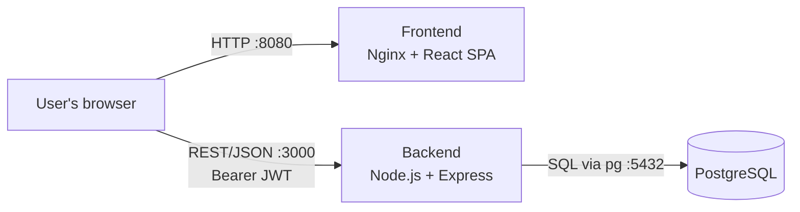
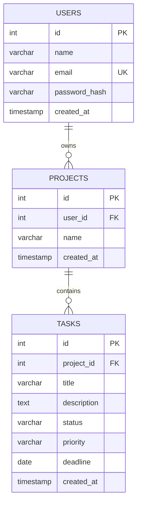
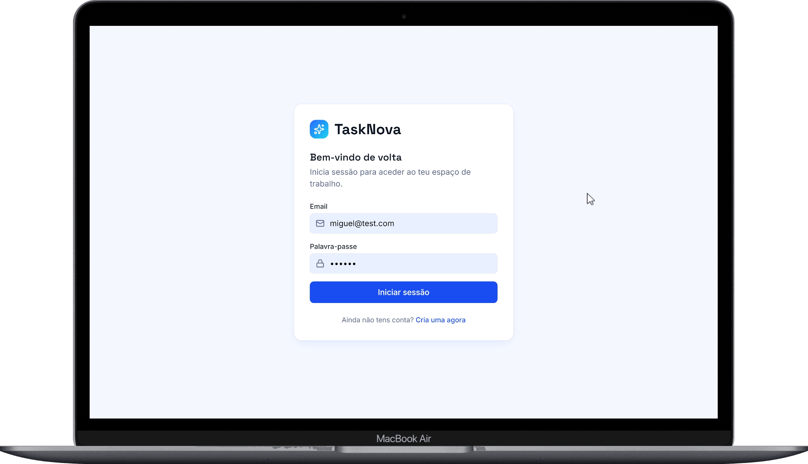
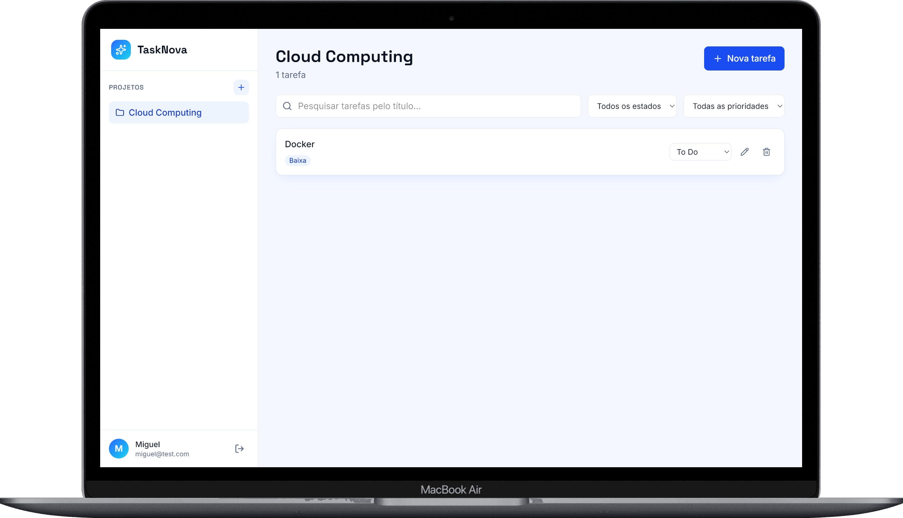
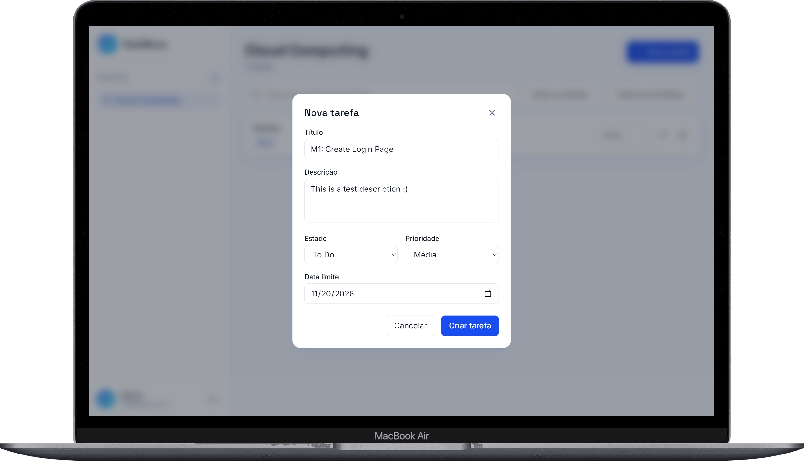
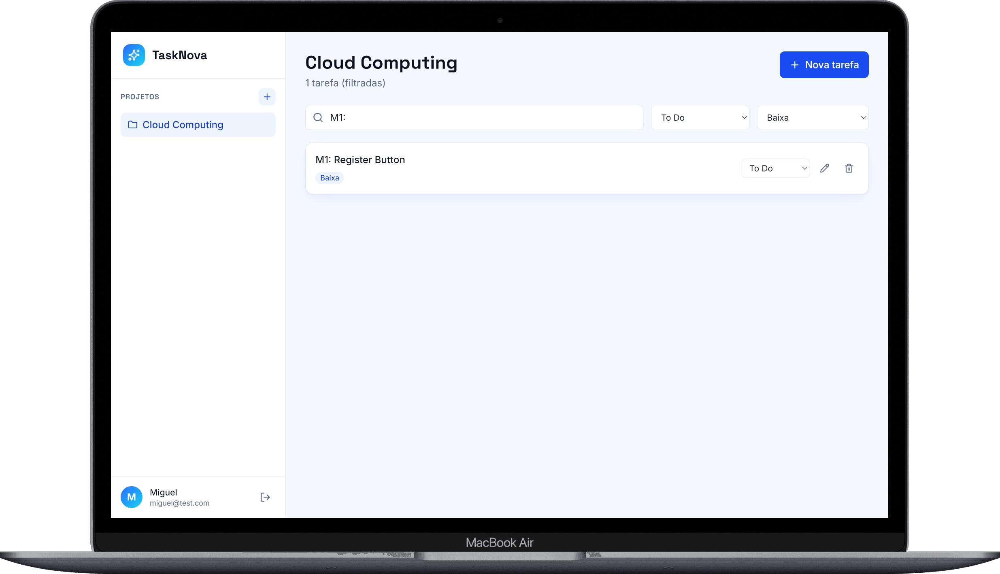

# TaskNova: Professional Workflow Manager

## 1. Project Title

**TaskNova: Professional Workflow Manager**

## 2. Project Overview

TaskNova is a professional workflow manager designed to help individuals and small teams organize their daily work into dedicated projects and folders. It solves the problem of scattered tasks and missed deadlines by providing a structured workspace with a project sidebar, priority levels, and status tracking. The target users are students, software developers, and professionals. In a general usage scenario, a user logs in, creates project folders in the sidebar, and manages tasks with specific deadlines and statuses inside the main workspace.

## 3. Target Users

Software engineering students, IT professionals, project teams, and individual users seeking an agile productivity tool.

## 4. Core Functionalities

1. User can register and log in to access their personal workspace.
2. User can create and delete projects/folders in the sidebar to organize their tasks.
3. User can create a new task within a selected project (with title, description, priority, and deadline).
4. User can update the status or details of a task (e.g., Backlog, To Do, In Progress, Done).
5. User can filter tasks by status or priority level, and delete tasks.

## 5. Non-Functional Requirements

- **Language:** The entire project is written in JavaScript (Node.js on the backend, React on the frontend).
- **Code readability and maintainability:** The code follows a modular structure (separate folders for routes, controllers, middleware and configuration), uses meaningful names and is committed in small, descriptive steps.
- **Input validation:** All user input is validated on the client side (forms) and on the server side (API) before being processed or stored.
- **Error handling:** The backend uses `try/catch` with correct HTTP status codes (200, 201, 400, 401, 404, 500). The frontend shows clear feedback to the user through toast notifications and never uses `window.alert` or `window.confirm`.
- **Responsive UI:** The interface adapts to desktop, tablet and mobile screens using Tailwind CSS.
- **Basic security:** Passwords are hashed with `bcryptjs`, authentication uses JSON Web Tokens (JWT), protected routes require a valid token, SQL queries are parameterized to prevent SQL injection, and secrets are stored in environment variables (`.env`) that are never committed to the repository.
- **Docker support:** The whole application (frontend, backend and database) runs in containers orchestrated with Docker Compose.
- **GitHub repository:** The source code is hosted in a public GitHub repository, with frequent commits and a Kanban project board.
- **Markdown documentation:** The project is documented in this `README.md` and in a companion Google Doc.

## 6. Technology Stack

| Layer                | Technology                                                                                              |
| -------------------- | ------------------------------------------------------------------------------------------------------- |
| **Frontend**         | React (Vite), Tailwind CSS, React Router DOM, Axios, Sonner (toast notifications), Lucide React (icons) |
| **Backend**          | Node.js, Express.js, `pg` (PostgreSQL client), `bcryptjs`, `jsonwebtoken`, `cors`, `dotenv`             |
| **Database**         | PostgreSQL                                                                                              |
| **DevOps and tools** | Docker, Docker Compose, Git, GitHub (repository and Project board), Postman (API testing)               |

## 7. System Architecture

TaskNova follows a classic three-tier architecture: a React single-page application (frontend), a REST API built with Express (backend) and a PostgreSQL relational database. The three tiers run as separate containers orchestrated with Docker Compose.

| Aspect             | Description                                                                                                                                                                                                                                                           |
| ------------------ | --------------------------------------------------------------------------------------------------------------------------------------------------------------------------------------------------------------------------------------------------------------------- |
| **Frontend**       | React SPA built with Vite and styled with Tailwind CSS. React Router handles the pages (`/login`, `/register`, `/`). The compiled static files are served by Nginx, which falls back to `index.html` so deep links work.                                              |
| **Backend**        | Express REST API organized in `routes/`, `controllers/`, `middleware/` and `config/`. Controllers hold the business logic and use parameterized SQL queries.                                                                                                          |
| **Database**       | PostgreSQL 16 with three related tables (see section 8). The schema is created automatically on first start through `docker-entrypoint-initdb.d`.                                                                                                                     |
| **Communication**  | The browser calls the API directly over HTTP using JSON. CORS is enabled on the backend.                                                                                                                                                                              |
| **Authentication** | Passwords are hashed with `bcryptjs`. On login the server issues a signed JWT (7 days). The frontend stores it in `localStorage` and an Axios interceptor sends it in the `Authorization: Bearer` header. A `protect` middleware validates it on every private route. |
| **Authorization**  | Every project and task query is filtered by the authenticated user, so users can only access their own data.                                                                                                                                                          |
| **Deployment**     | Docker Compose runs three containers (`db`, `backend`, `frontend`). The database uses a named volume for persistence and a health check; the backend starts only after the database is healthy.                                                                       |

### Main modules

| Module                                                  | Responsibility                                                                         |
| ------------------------------------------------------- | -------------------------------------------------------------------------------------- |
| `AuthContext` / `useAuth`                               | Shares the logged-in user and the login, register and logout functions                 |
| `ProtectedRoute`                                        | Redirects unauthenticated users to `/login`                                            |
| `Sidebar`                                               | Lists, creates, selects and deletes projects                                           |
| `TaskBoard`                                             | Toolbar (search and filters) and task list with create, edit, status change and delete |
| `Modal` family                                          | Custom modals (`Modal`, `ConfirmModal`, `CreateProjectModal`, `TaskModal`)             |
| `authController`, `projectController`, `taskController` | Backend business logic                                                                 |

## 8. Data Model

The application uses a relational PostgreSQL database with three entities. A user owns many projects, and a project contains many tasks. Deleting a project or a user removes the dependent records (`ON DELETE CASCADE`).

| Entity     | Key fields                                                                                                                                                           |
| ---------- | -------------------------------------------------------------------------------------------------------------------------------------------------------------------- |
| `users`    | `id`, `name`, `email` (unique), `password_hash`, `created_at`                                                                                                        |
| `projects` | `id`, `user_id` (FK), `name`, `created_at`                                                                                                                           |
| `tasks`    | `id`, `project_id` (FK), `title`, `description`, `status` (`backlog`, `todo`, `in_progress`, `done`), `priority` (`low`, `medium`, `high`), `deadline`, `created_at` |

## 9. API Scope

All endpoints are prefixed with `/api`. Every endpoint except register and login requires the header `Authorization: Bearer <token>`.

| Method | Endpoint                     | Description                                                       | Auth |
| ------ | ---------------------------- | ----------------------------------------------------------------- | ---- |
| POST   | `/auth/register`             | Register a new user                                               | No   |
| POST   | `/auth/login`                | Log in and receive a JWT                                          | No   |
| GET    | `/auth/me`                   | Get the authenticated user                                        | Yes  |
| GET    | `/projects`                  | List the user's projects                                          | Yes  |
| POST   | `/projects`                  | Create a project                                                  | Yes  |
| DELETE | `/projects/:id`              | Delete a project and its tasks                                    | Yes  |
| GET    | `/projects/:projectId/tasks` | List tasks of a project (filters: `status`, `priority`, `search`) | Yes  |
| POST   | `/projects/:projectId/tasks` | Create a task in a project                                        | Yes  |
| PUT    | `/tasks/:id`                 | Update a task (partial update)                                    | Yes  |
| DELETE | `/tasks/:id`                 | Delete a task                                                     | Yes  |

A Postman collection with example requests is available in [`docs/TaskNova.postman_collection.json`](docs/TaskNova.postman_collection.json).

--- |

## 10. Project Management Plan

- **GitHub repository:** https://github.com/rafael17cordeiro/tasknova
- **GitHub Project board:** https://github.com/users/rafael17cordeiro/projects/5/views/1

### Milestones

| Milestone                    | Tag  | Scope                                                                                                                                  |
| ---------------------------- | ---- | -------------------------------------------------------------------------------------------------------------------------------------- |
| M1: Initialization           | `C0` | Concept, requirements, technology stack, repository and Kanban board                                                                   |
| M2: Backend                  | `M2` | Express server, PostgreSQL in Docker, relational schema, JWT authentication, REST endpoints for projects and tasks, Postman collection |
| M3: Frontend                 | `M3` | React SPA with Tailwind theme, login/register, sidebar, task board, custom modals, validation and toast feedback                       |
| M4: DevOps and documentation | `M4` | Dockerfiles, Docker Compose, clean-clone test and final documentation                                                                  |

### Branch strategy

Development was done on the `main` branch with small, frequent commits following the Conventional Commits style (`feat:`, `fix:`, `docs:`, `refactor:`, `chore:`). Each completed milestone is marked with an annotated Git tag, so every delivery stage can be inspected in the history.

### Task breakdown

Work was tracked on the Kanban board (`Todo`, `In Progress`, `Done`) with one card per task, grouped by milestone (M0 to M4).

## 11. Testing

### Backend API

All endpoints were tested manually with **Postman**. The exported collection is in [`docs/TaskNova.postman_collection.json`](docs/TaskNova.postman_collection.json). The `Login` request stores the JWT in an environment variable that the other requests reuse.

### Frontend

The frontend was tested manually in the browser, following each core functionality end to end (registration, login, project and task management, filters and logout).

### Example test cases

| #   | Test case                                                | Expected result                                     | Result |
| --- | -------------------------------------------------------- | --------------------------------------------------- | ------ |
| 1   | Register with a new email                                | `201`, user and token returned                      | Passed |
| 2   | Register with an existing email                          | `400`, `Email already registered`                   | Passed |
| 3   | Login with wrong password                                | `401`, `Invalid credentials`                        | Passed |
| 4   | `GET /auth/me` without token                             | `401`, `Not authorized: token missing`              | Passed |
| 5   | Create a project with an empty name                      | `400`, name required                                | Passed |
| 6   | Delete a project that does not exist                     | `404`, `Project not found`                          | Passed |
| 7   | Update a task with an invalid status                     | `400`, `Invalid status`                             | Passed |
| 8   | Filter tasks by `priority=high`                          | Only high-priority tasks returned                   | Passed |
| 9   | Submit the login form with empty fields                  | Validation messages, no request sent                | Passed |
| 10  | Delete a project that has tasks                          | Project and its tasks removed (`ON DELETE CASCADE`) | Passed |
| 11  | Reload the page while logged in                          | Session is kept                                     | Passed |
| 12  | Clone the repository and run `docker compose up --build` | Application works at `http://localhost:8080`        | Passed |

### Limitations of the testing

No automated unit or integration tests were written. Adding them (for example Jest with Supertest for the API and Vitest with React Testing Library for the frontend) is listed under future improvements.

## 13. Final Documentation

### Purpose

TaskNova helps individuals and small teams organize their work into projects and tasks, with priorities, deadlines and statuses, in a single, clean workspace.

### Features

- User registration and login with JWT authentication
- Private workspace per user (users only see their own data)
- Create and delete projects in a sidebar
- Create, edit and delete tasks with title, description, priority, status and deadline
- Quick status change directly from the task list
- Search by title and filters by status and priority
- Overdue deadlines highlighted
- Custom modals and toast notifications (no `alert` or `confirm`)
- Client-side and server-side validation
- Full application in Docker with a single command

### Screenshots

| Login                                | Dashboard                                    |
| ------------------------------------ | -------------------------------------------- |
|  |  |

| Task modal                                     | Filters                                  |
| ---------------------------------------------- | ---------------------------------------- |
|  |  |

### Limitations

- No automated tests (manual testing only).
- The JWT is stored in `localStorage`, which is exposed to XSS attacks; `httpOnly` cookies would be more secure.
- No password recovery, email verification or login rate limiting.
- No project renaming and no pagination of tasks.
- The application runs over HTTP only; a production deployment would need HTTPS.
- Server error messages are in English while the interface is in Portuguese.
- The interface language is fixed (no internationalization).

### Future improvements

- Automated tests (Jest, Supertest, Vitest, React Testing Library) and a CI pipeline with GitHub Actions
- Kanban drag-and-drop view and task pagination
- Shared projects and role-based access for teams
- Password reset by email and rate limiting
- Dark mode toggle
- Deployment to a cloud provider with HTTPS
