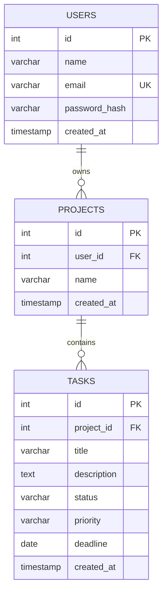

# TaskNova: Professional Workflow Manager

## 1. Project Title

**TaskNova: Professional Workflow Manager**

## 2. Project Overview

TaskNova is a professional workflow manager designed to help individuals and small teams organize their daily work into dedicated projects and folders. It solves the problem of scattered tasks and missed deadlines by providing a structured workspace with a project sidebar, priority levels, and status tracking. The target users are students, software developers, and professionals. In a general usage scenario, a user logs in, creates project folders in the sidebar, and manages tasks with specific deadlines and statuses inside the main workspace.

## 3. Target Users

Software engineering students, IT professionals, project teams, and individual users seeking an agile productivity tool.

## 4. Core Functionalities

1. User can register and log in to access their personal workspace.
2. User can create and delete projects/folders in the sidebar to organize their tasks.
3. User can create a new task within a selected project (with title, description, priority, and deadline).
4. User can update the status or details of a task (e.g., Backlog, To Do, In Progress, Done).
5. User can filter tasks by status or priority level, and delete tasks.

## 5. Non-Functional Requirements

- **Language:** The entire project is written in JavaScript (Node.js on the backend, React on the frontend).
- **Code readability and maintainability:** The code follows a modular structure (separate folders for routes, controllers, middleware and configuration), uses meaningful names and is committed in small, descriptive steps.
- **Input validation:** All user input is validated on the client side (forms) and on the server side (API) before being processed or stored.
- **Error handling:** The backend uses `try/catch` with correct HTTP status codes (200, 201, 400, 401, 404, 500). The frontend shows clear feedback to the user through toast notifications and never uses `window.alert` or `window.confirm`.
- **Responsive UI:** The interface adapts to desktop, tablet and mobile screens using Tailwind CSS.
- **Basic security:** Passwords are hashed with `bcryptjs`, authentication uses JSON Web Tokens (JWT), protected routes require a valid token, SQL queries are parameterized to prevent SQL injection, and secrets are stored in environment variables (`.env`) that are never committed to the repository.
- **Docker support:** The whole application (frontend, backend and database) runs in containers orchestrated with Docker Compose.
- **GitHub repository:** The source code is hosted in a public GitHub repository, with frequent commits and a Kanban project board.
- **Markdown documentation:** The project is documented in this `README.md` and in a companion Google Doc.

## 6. Technology Stack

| Layer                | Technology                                                                                              |
| -------------------- | ------------------------------------------------------------------------------------------------------- |
| **Frontend**         | React (Vite), Tailwind CSS, React Router DOM, Axios, Sonner (toast notifications), Lucide React (icons) |
| **Backend**          | Node.js, Express.js, `pg` (PostgreSQL client), `bcryptjs`, `jsonwebtoken`, `cors`, `dotenv`             |
| **Database**         | PostgreSQL                                                                                              |
| **DevOps and tools** | Docker, Docker Compose, Git, GitHub (repository and Project board), Postman (API testing)               |

## 8. Data Model

The application uses a relational PostgreSQL database with three entities. A user owns many projects, and a project contains many tasks. Deleting a project or a user removes the dependent records (`ON DELETE CASCADE`).

| Entity     | Key fields                                                                                                                                                           |
| ---------- | -------------------------------------------------------------------------------------------------------------------------------------------------------------------- |
| `users`    | `id`, `name`, `email` (unique), `password_hash`, `created_at`                                                                                                        |
| `projects` | `id`, `user_id` (FK), `name`, `created_at`                                                                                                                           |
| `tasks`    | `id`, `project_id` (FK), `title`, `description`, `status` (`backlog`, `todo`, `in_progress`, `done`), `priority` (`low`, `medium`, `high`), `deadline`, `created_at` |

## 9. API Scope

All endpoints are prefixed with `/api`. Every endpoint except register and login requires the header `Authorization: Bearer <token>`.

| Method | Endpoint                     | Description                                                       | Auth |
| ------ | ---------------------------- | ----------------------------------------------------------------- | ---- |
| POST   | `/auth/register`             | Register a new user                                               | No   |
| POST   | `/auth/login`                | Log in and receive a JWT                                          | No   |
| GET    | `/auth/me`                   | Get the authenticated user                                        | Yes  |
| GET    | `/projects`                  | List the user's projects                                          | Yes  |
| POST   | `/projects`                  | Create a project                                                  | Yes  |
| DELETE | `/projects/:id`              | Delete a project and its tasks                                    | Yes  |
| GET    | `/projects/:projectId/tasks` | List tasks of a project (filters: `status`, `priority`, `search`) | Yes  |
| POST   | `/projects/:projectId/tasks` | Create a task in a project                                        | Yes  |
| PUT    | `/tasks/:id`                 | Update a task (partial update)                                    | Yes  |
| DELETE | `/tasks/:id`                 | Delete a task                                                     | Yes  |

A Postman collection with example requests is available in [`docs/TaskNova.postman_collection.json`](docs/TaskNova.postman_collection.json).

--- |

## 10. Project Management Plan

- **GitHub repository:** https://github.com/rafael17cordeiro/tasknova
- **GitHub Project board:** https://github.com/users/rafael17cordeiro/projects/5/views/1

> This section will be completed with milestones, branch strategy and task breakdown in Milestone 4.

> The remaining sections (7 to 13) will be added progressively as the project evolves.
